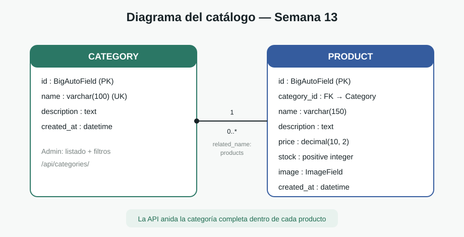
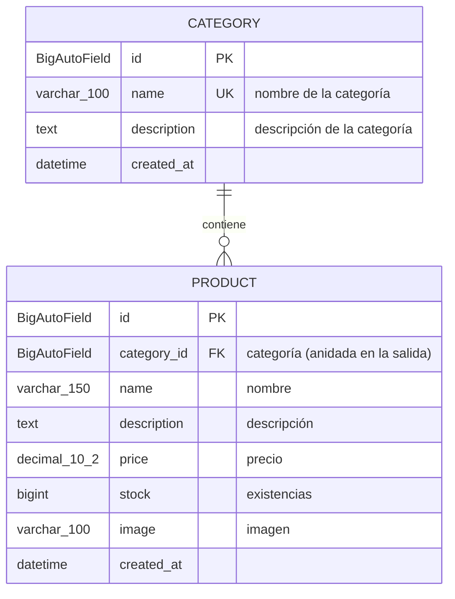

# 1. Diagrama del catálogo

## Decisiones del modelo

- `Category.name` es única; `description` es obligatoria y es la que se muestra anidada en cada producto.
- `Product.category` es una FK con `related_name="products"` y `on_delete=CASCADE`.
- `Product.price` usa `DecimalField(10, 2)` para no perder precisión en importes.
- `Product.stock` es `PositiveIntegerField` (existencias).
- `Product.image` es `ImageField(upload_to="products/")`; es opcional para permitir altas sin archivo
  y mostrar un placeholder. `seed_catalog` genera 10 PNG con Pillow.
- La serialización expone `category` como objeto de solo lectura y `category_id` como campo de
  escritura, de modo que el listado devuelve la descripción de la categoría y no solo su id.
