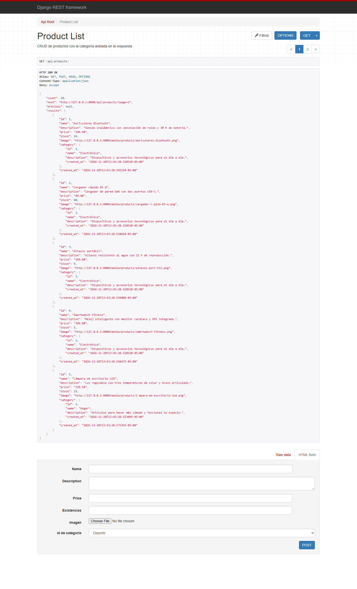
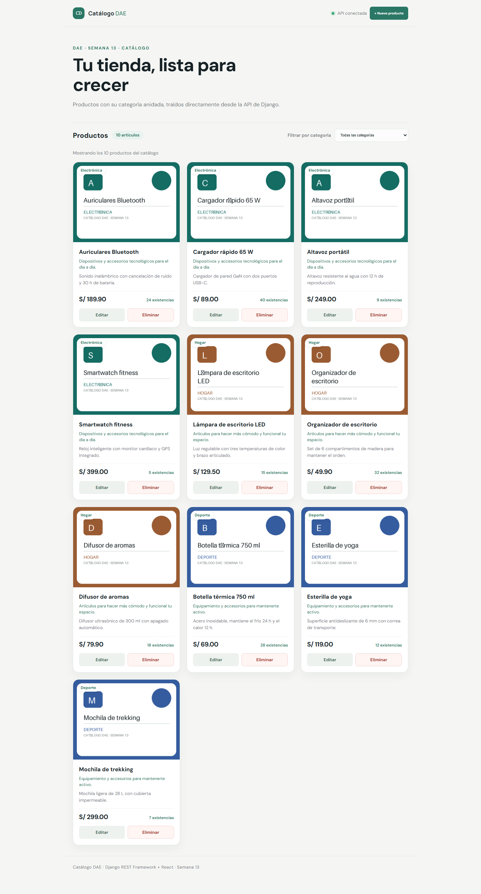
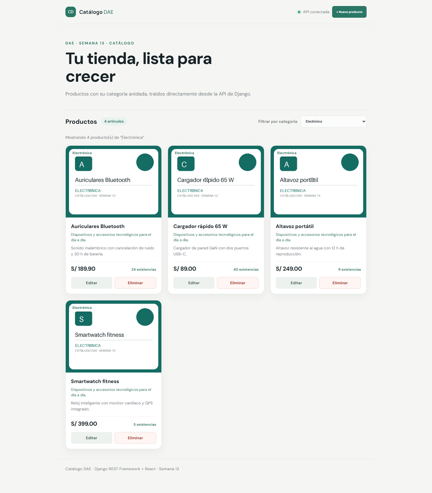
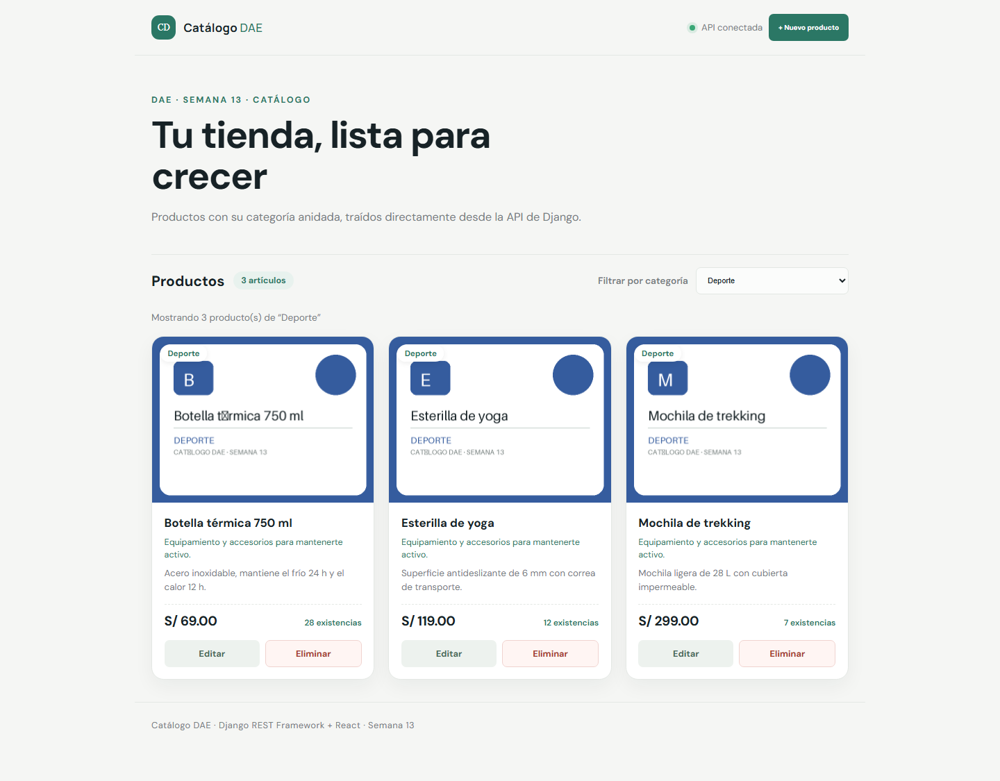
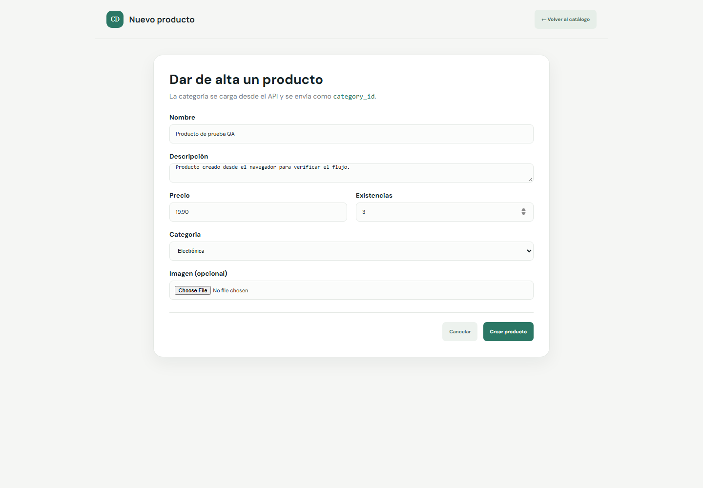
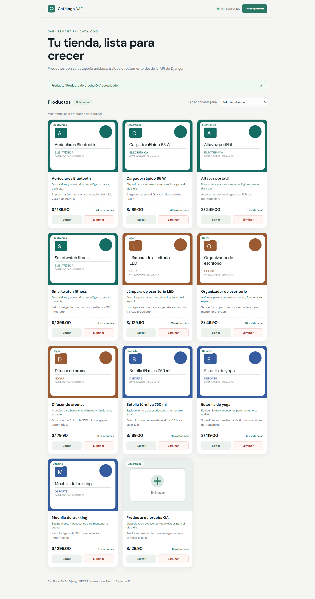
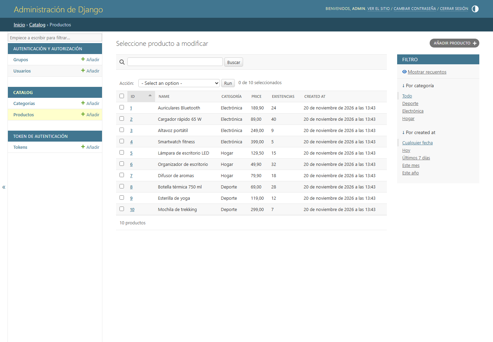

# 3. Capturas del catálogo funcionando

## API con la categoría anidada

`GET /api/products/` → cada producto trae `category.description`, no solo el id.

## Catálogo completo (10 productos)

Tarjetas con imagen, precio, existencias y la descripción de la categoría anidada.

## Filtrado por categoría

El desplegable se llena con `GET /api/categories/`. Al elegir **Electrónica** la petición es
`GET /api/products/?category=1` y se muestran 4 productos.

Al elegir **Deporte**: `GET /api/products/?category=3` y 3 productos.

## Alta, edición y borrado

Formulario controlado con la lista de categorías cargada por servicio:

Tras crear, editar (precio `S/ 29.90`) y borrar un producto, el catálogo se actualiza sin recargar:

## Administración de Django

Ambos modelos registrados con `list_display`, `list_filter` y `search_fields`:

